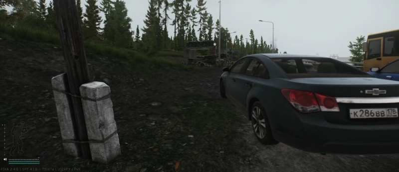

# Wheres my body

Look down in a raid or in your hideout and see your own body. Your torso, armor, rig, backpack, holstered pistol and knife show as your character wears them.

## Install
SPT 4.1.x. Client only.

1. Download the zip.
2. Extract it into your SPT folder.

To update, extract over the old one. To remove, delete `BepInEx\plugins\WheresMyBody`.

## Issues
Please report issues on [GitHub issues](https://github.com/MrFums/WheresMyBody/issues).
